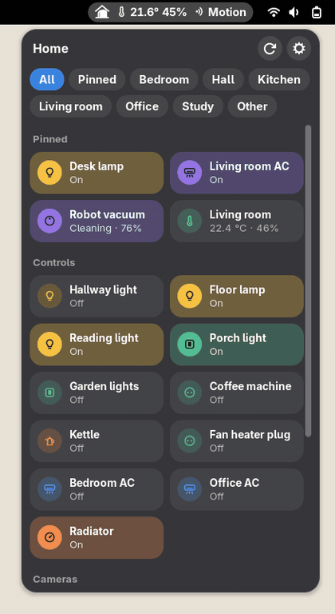
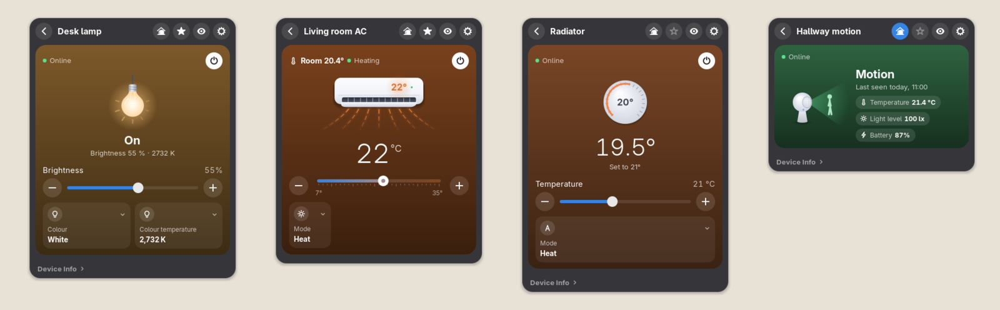
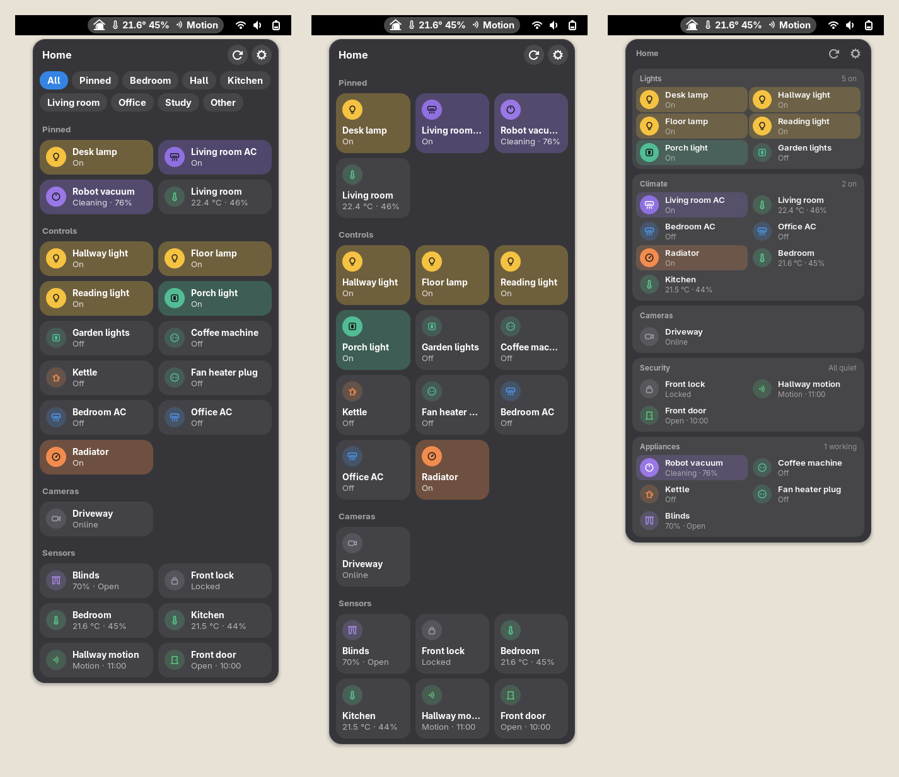

<p align="center">
  
</p>

<h1 align="center">Nook</h1>

<p align="center">
  Your smart home in the GNOME top bar.<br>
  Lights, climate, sensors, cameras, speakers and TVs, one click away.
</p>

<p align="center">
  <a href="https://github.com/sponsors/epogonii"></a>
  <a href="https://www.paypal.com/paypalme/pogonii"></a>
</p>

<p align="center">
  
</p>

Nook is a GNOME Shell extension that brings the devices of your home into one menu, whatever
app or hub they live in. It talks to most of them directly on your network, and to the rest
through the account you already have. Nothing to host, no extra hub.

## Works with

| | |
|---|---|
| **Hubs and bridges** | Home Assistant · HomeKit · Philips Hue |
| **Accounts** | Smart Life · Tuya · Mi Home · eWeLink |
| **On your network** | Sonoff in DIY mode · Tapo and ONVIF cameras · Google Cast speakers |
| **Air conditioners** | Gree, Midea and Daikin on your network · LG ThinQ · Samsung SmartThings · Mitsubishi MELCloud · Electrolux · Xiaomi through Mi Home |
| **TVs** | Samsung · LG · Sony · Panasonic · Philips · Roku · Android TV · Google TV · Apple TV |

Each one is added the way its own app does it: a token for Home Assistant, the button on the
Hue bridge, the code on a HomeKit accessory, a QR code for Smart Life and Mi Home, a PIN or a
prompt on a TV, the login or a token of an air conditioner's own cloud. Anything else that
Home Assistant knows comes in through Home Assistant.

## A closer look

<p align="center">
  
</p>

- **Tiles** switch with one click. A **card** holds the rest: brightness and colour, modes and
  target temperature, positions, readings and device info.
- **Rooms** come from your apps and turn into tabs.
- **Top bar readings**: pin a thermometer or a door sensor and its value sits next to the icon.
- **TVs** show the app or channel that is on; the card holds the volume, the inputs, the apps
  and a remote.
- **Speakers** show what is playing and the time left, with play, pause and next. A speaker
  playing in a group shows the group's playback.
- **Cameras** play live in their card, turn if they can, and save a snapshot to `Pictures/Nook`.
- **Alerts**: a leak or smoke sensor behind a Xiaomi gateway becomes a notification the moment
  it fires, also on the lock screen.
- **Four layouts**: rooms as tabs, small tiles, tiles by room, or modules grouped by what things do.

<p align="center">
  
</p>

## Install

Nook runs on GNOME 46 to 51.

```sh
git clone https://github.com/epogonii/nook.git
cd nook
tools/install-local.sh
```

Log out and back in, turn Nook on in **Extensions**, then open its settings. Add accounts and
hubs on the **Accounts** page; **Find Devices** on the **Devices** page looks for everything on
your network at once.

Camera video needs GStreamer with RTSP and an H.264 decoder (`gst-plugins-good` and `gst-libav` or `openh264`).
Pairing an Android TV needs `openssl`.

I don't have every device listed above at home. Support for the ones I couldn't try is built
from their public documentation and APIs, and from open source projects that already talk to
them, so something may not work on a real unit. If yours doesn't, please
[open an issue](https://github.com/epogonii/nook/issues).

## Privacy

- Devices on your network are reached directly; nothing goes through a server of ours. A newer
  Midea air conditioner gets its key from Midea's cloud once, when it is added.
- Logins and pairing keys stay in the GNOME keyring, never in settings.
- Cloud accounts are asked only when the menu opens, and every few minutes for readings shown in
  the top bar. Never while the screen is locked.
- While the screen is locked, Nook only listens on your network for a Xiaomi gateway's alerts.
  No menu, no cloud.

## Support Nook

If Nook makes your home nicer to live with, you can support its development.

<p>
  <a href="https://github.com/sponsors/epogonii"></a>
  <a href="https://www.paypal.com/paypalme/pogonii"></a>
</p>

The same links, and the crypto addresses with QR codes, are under **About** in Nook's settings:

| | |
|---|---|
| **PayPal** | [paypal.me/pogonii](https://www.paypal.com/paypalme/pogonii) |
| **Bitcoin** | `bc1qe6fjj3uv23e2yx2ry3wwhyrl7s2pqshau7mga3` |
| **Ethereum** | `0xDC9e1EfA0F8FAE71377F4018d4ff7D123369438e` |
| **Solana** | `3sYQyR27CVz1VcwCfoDLUioaAHk8jspQaSDHXEvBALxg` |

## License

[GPL-2.0-or-later](LICENSE).
