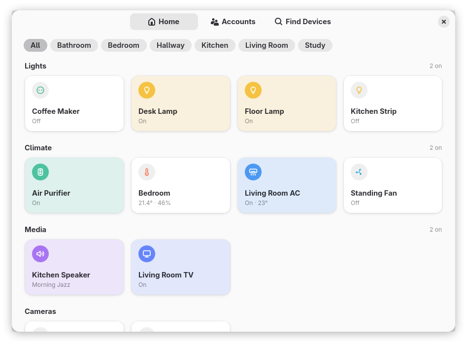

# Nook app

Lights, plugs, sensors, cameras, air conditioners, TVs and speakers in one
window. The Home page shows every device by section and room; the other pages
sign in to the accounts and find and pair devices on the network.

With the [Nook](https://github.com/epogonii/nook) extension the same devices
are also in the GNOME top bar: the extension draws the menu and asks this app
for everything over D-Bus. GNOME Shell starts the app when the extension needs
it, and it keeps running while the extension uses it, which is why GNOME lists
it under Background Apps.

## Installing

From [Flathub](https://flathub.org/apps/io.github.epogonii.nook):

    flatpak install flathub io.github.epogonii.nook

On Fedora, from [COPR](https://copr.fedorainfracloud.org/coprs/swink/nook/):

    sudo dnf copr enable swink/nook
    sudo dnf install nook

Logins are kept in the keyring through the Secret portal. The ones the extension
saved before this app existed are handed over once, the first time it starts it.

## What the Flatpak is allowed

| Permission | For |
| --- | --- |
| `--share=network` | devices on the LAN (broadcast, multicast, mDNS) and the vendors' clouds |
| `--system-talk-name=org.bluez` | adverts of Xiaomi Bluetooth thermometers |
| `--system-talk-name=org.freedesktop.Avahi` | mDNS discovery of speakers, TVs, Hue, Home Assistant, HomeKit and Shelly |
| `--socket=wayland`, `--socket=fallback-x11`, `--share=ipc`, `--device=dri` | the window |

## Building

    meson setup build
    meson compile -C build
    meson test -C build

## License

GPL-2.0-or-later.
