<p align="center">
  
</p>

<h1 align="center">Nook</h1>

<p align="center">
  Your smart home in the GNOME top bar.<br>
  Lights, climate, sensors, cameras, speakers and TVs, one click away.
</p>

<p align="center">
  
</p>

Nook is a GNOME Shell extension that brings the devices of your home into one menu, whatever
app or hub they live in. It talks to most of them directly on your network, and to the rest
through the account you already have. Nothing to host, no extra hub.

## Works with

| | |
|---|---|
| **Hubs and bridges** | Home Assistant · HomeKit · Philips Hue |
| **Accounts** | Smart Life · Tuya · Mi Home · eWeLink |
| **On your network** | Gree air conditioners · Sonoff in DIY mode · Tapo and ONVIF cameras · Google Cast speakers |
| **TVs** | Samsung · LG · Sony · Panasonic · Philips · Roku · Android TV · Google TV · Apple TV |

Each one is added the way its own app does it: a token for Home Assistant, the button on the
Hue bridge, the code on a HomeKit accessory, a QR code for Smart Life and Mi Home, a PIN or a
prompt on a TV.

## A closer look

<p align="center">
  
</p>

- **Tiles** switch with one click. A **card** holds the rest: brightness and colour, modes and
  target temperature, positions, readings and device info.
- **Rooms** come from your apps and turn into tabs.
- **Top bar readings**: pin a thermometer or a door sensor and its value sits next to the icon.
- **Four layouts**: rooms as tabs, small tiles, tiles by room, or modules grouped by what things do.

<p align="center">
  
</p>

## Install

Nook runs on GNOME 46 to 50.

```sh
git clone https://github.com/epogonii/nook.git
cd nook
tools/install-local.sh
```

Log out and back in, turn Nook on in **Extensions**, then open its settings. Add accounts and
hubs on the **Accounts** page; **Find Devices** on the **Devices** page looks for everything on
your network at once.

Camera video needs GStreamer with RTSP and an H.264 decoder (`gst-plugins-good` and `gst-libav` or `openh264`).
Pairing an Android TV needs `openssl`.

## Privacy

- Devices on your network are reached directly; nothing goes through a server of ours.
- Logins and pairing keys stay in the GNOME keyring, never in settings.
- Cloud accounts are asked only when the menu opens, and every few minutes for readings shown in
  the top bar. Never while the screen is locked.

## License

[GPL-2.0-or-later](LICENSE). If Nook makes your home nicer to live with, you can
[sponsor it](https://github.com/sponsors/epogonii).
