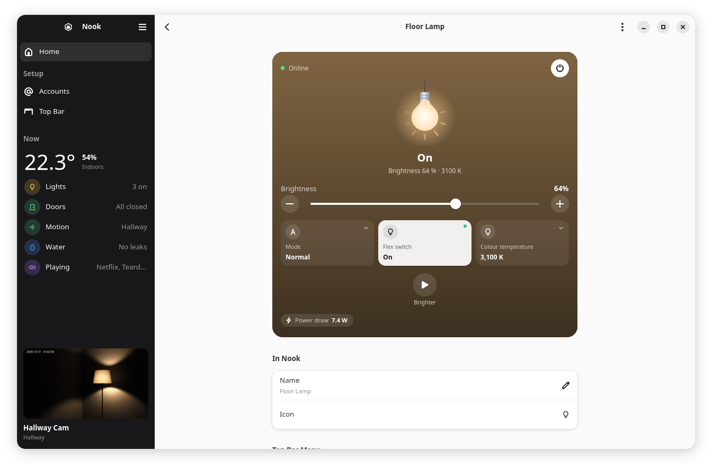
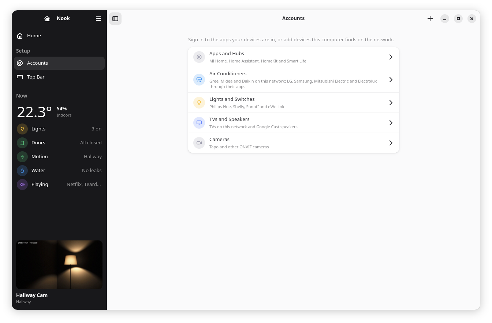
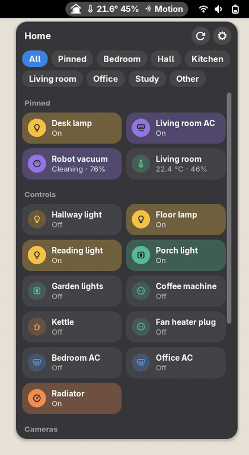
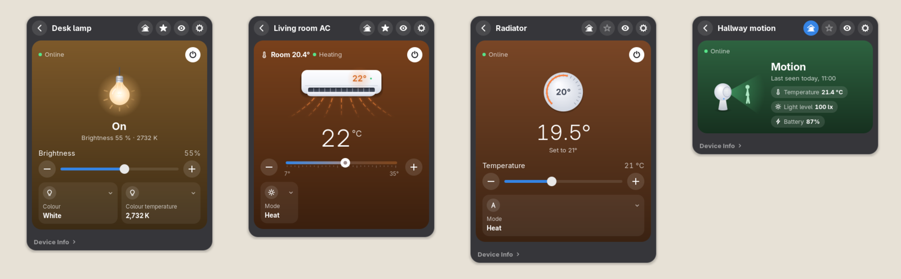
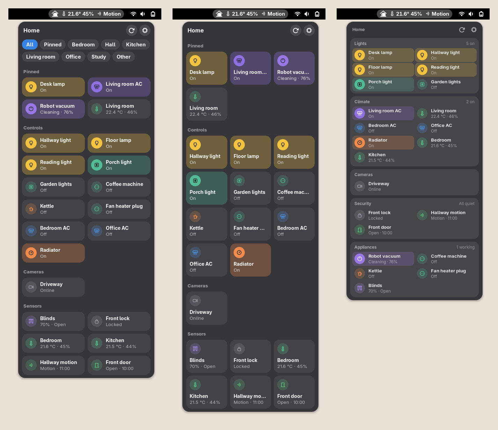
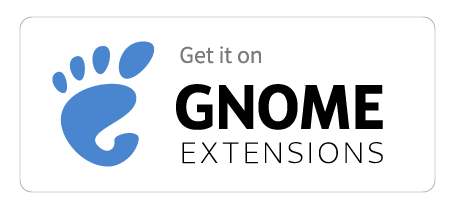

<p align="center">
  
</p>

<h1 align="center">Nook</h1>

<p align="center">
  Your smart home on the GNOME desktop.<br>
  Lights, climate, sensors, cameras, speakers and TVs, in a window of their own and in the top bar.
</p>

<p align="center">
  
  
  
  <a href="LICENSE"></a>
  <a href="https://github.com/epogonii/nook/commits/main"></a>
  <a href="https://github.com/sponsors/epogonii"></a>
  <a href="https://www.paypal.com/paypalme/pogonii"></a>
</p>

<p align="center">
  
</p>

Nook brings the devices of your home together, whatever app or hub they live in. It talks to
most of them directly on your network, and to the rest through the account you already have.
Nothing to host, no extra hub.

It comes in two parts. The **Nook app** is where the devices live: its window shows the whole
home, signs in to your accounts and finds and pairs what is on your network. The **Nook
extension** puts the same devices in a menu in the GNOME top bar; it draws the menu and asks
the app for everything else.

## Works with

| | |
|---|---|
| **Hubs and bridges** | Home Assistant · HomeKit · Philips Hue |
| **Accounts** | Smart Life · Tuya · Mi Home · eWeLink |
| **On your network** | Sonoff in DIY mode · Shelly · Tapo and ONVIF cameras · Google Cast speakers |
| **Air conditioners** | Gree, Midea and Daikin on your network · LG ThinQ · Samsung SmartThings · Mitsubishi MELCloud · Electrolux · Xiaomi through Mi Home |
| **TVs** | Samsung · LG · Sony · Panasonic · Philips · Roku · Android TV · Google TV · Apple TV |

Each one is added the way its own app does it: a token for Home Assistant, the button on the
Hue bridge, the code on a HomeKit accessory, a QR code for Smart Life and Mi Home, a PIN or a
prompt on a TV, the login or a token of an air conditioner's own cloud. Anything else that
Home Assistant knows comes in through Home Assistant.

## The app

- **Home** shows every device as a picture, in sections for lights, climate, media, cameras,
  security and appliances, with a tab for each room. A speaker that is playing and an air
  conditioner that is on get a card of their own at the top.
- **Now**: the sidebar sums up the home. The temperature indoors, the lights that are on, the
  doors and windows, motion, leaks, what is playing, and a camera.
- **Device pages** hold the controls and the details: brightness and colour, modes and target
  temperature, readings and their history, the name and the icon, and what the top bar shows of
  the device.
- **Accounts** signs in to the apps and hubs above and to the clouds of air conditioners;
  **Add Devices** looks for everything on your network at once.
- **Backgrounds**: twelve come with the app, or pick a picture of your own.

<p align="center">
   
</p>

## The top bar

<p align="center">
  
</p>

- **Tiles** switch with one click. A **card** holds the rest: brightness and colour, modes and
  target temperature, positions, readings and device info.
- **Rooms** come from your apps; the room picker above the tiles shows one at a time.
- **Tabs at the bottom**: Home and up to six sections such as lights, climate or cameras, picked
  from the devices you have or by hand, as a bar or a floating pill.
- **Top bar readings**: pin a thermometer or a door sensor and its value sits next to the icon.
- **TVs** show the app or channel that is on; the card holds the volume, the inputs, the apps
  and a remote.
- **Speakers** show what is playing and the time left, with play, pause and next. A speaker
  playing in a group shows the group's playback.
- **Cameras** play live in their card, turn if they can, and save a snapshot to `Pictures/Nook`.
- **Scenes** from Home Assistant and Mi Home run from a tile of their own.
- **Alerts**: a leak or smoke sensor behind a Xiaomi gateway becomes a notification the moment
  it fires, also on the lock screen.
- **Four layouts**: one room at a time, small tiles, tiles by room, or modules grouped by what
  things do. The **Top Bar** page of the app sets them up.

<p align="center">
  
</p>

<p align="center">
  
</p>

## Install

### The app

On Fedora 43 and later, install it from [Copr](https://copr.fedorainfracloud.org/coprs/swink/nook/):

```sh
sudo dnf copr enable swink/nook
sudo dnf install nook
```

Nook isn't on Flathub yet. Elsewhere, build it from this repository with Meson. It needs GJS,
GTK 4, libadwaita and libsecret. Camera video needs GStreamer with RTSP and an H.264 decoder
(`gst-plugins-good` and `gst-libav` or `openh264`); pairing an Android TV needs `openssl`.

```sh
git clone https://github.com/epogonii/nook.git
cd nook
meson setup build
sudo meson install -C build
```

### The extension

The extension runs on GNOME 46 to 51. It is in review on extensions.gnome.org:

<a href="https://extensions.gnome.org/extension/11453/nook/"></a>

Until it is published there, install it from a checkout of this repository:

```sh
extension/tools/install-local.sh
```

Log out and back in, then turn Nook on in **Extensions**. Its settings open the app, where
everything is set: accounts on the **Accounts** page, new devices through **Add Devices**, and
the menu on the **Top Bar** page. GNOME starts the app when the extension needs it.

I don't have every device listed above at home. Support for the ones I couldn't try is built
from their public documentation and APIs, and from open source projects that already talk to
them, so something may not work on a real unit. If yours doesn't, please
[open an issue](https://github.com/epogonii/nook/issues).

## Privacy

- Devices on your network are reached directly; nothing goes through a server of ours. A newer
  Midea air conditioner gets its key from Midea's cloud once, when it is added.
- Logins and pairing keys stay in the keyring, never in settings. Those the extension saved
  before the app existed are handed over to the app once, the first time it starts.
- Cloud accounts are asked while the window or the menu is open, and every few minutes for
  readings shown in the top bar. Those readings wait while the screen is locked.
- While the screen is locked there is no menu; only a Xiaomi gateway's leak and smoke alerts
  still become notifications.

As a Flatpak, the app is allowed:

| Permission | For |
| --- | --- |
| `--share=network` | devices on the LAN (broadcast, multicast, mDNS) and the vendors' clouds |
| `--system-talk-name=org.bluez` | adverts of Xiaomi Bluetooth thermometers |
| `--system-talk-name=org.freedesktop.Avahi` | mDNS discovery of speakers, TVs, Hue, Home Assistant, HomeKit and Shelly |
| `--filesystem=xdg-pictures/Nook:create` | camera snapshots, saved to `Pictures/Nook` |
| `--socket=pulseaudio` | a camera's sound, once turned on in the camera's page |
| `--socket=wayland`, `--socket=fallback-x11`, `--share=ipc`, `--device=dri` | the window |

## Support Nook

If Nook makes your home nicer to live with, you can support its development.

<p>
  <a href="https://github.com/sponsors/epogonii"></a>
  <a href="https://www.paypal.com/paypalme/pogonii"></a>
</p>

The same links, and the crypto addresses with QR codes, are under **Support Nook** in the app's
main menu:

| | |
|---|---|
| **PayPal** | [paypal.me/pogonii](https://www.paypal.com/paypalme/pogonii) |
| **Bitcoin** | `bc1qe6fjj3uv23e2yx2ry3wwhyrl7s2pqshau7mga3` |
| **Ethereum** | `0xDC9e1EfA0F8FAE71377F4018d4ff7D123369438e` |
| **Solana** | `3sYQyR27CVz1VcwCfoDLUioaAHk8jspQaSDHXEvBALxg` |

## License

[GPL-2.0-or-later](LICENSE).
